# Day 1 - Konfigurasi Dasar RouterOS: Uplink Wi-Fi, DHCP Server, dan NAT

> Platform: MikroTik hAP ax lite (L41G-2axD), RouterOS v7, WinBox · Training MTCNA, 19 Okt 2026

## 1. Tujuan

Menghubungkan router MikroTik ke internet lewat Wi-Fi training (router sebagai *station*), lalu membagikan internet ke laptop lewat kabel LAN. Tiga hal yang harus berjalan berurutan: router mendapat IP dari uplink (DHCP client), router memberi IP ke laptop (DHCP server), dan trafik laptop diterjemahkan ke IP uplink (NAT masquerade).

## 2. Topologi dan alamat

```
Internet --- Wi-Fi "IDN" --- [wifi1 | MikroTik hAP | ether2] --- Laptop
                              DHCP client           192.168.88.1/24
```

| Interface | Peran | Alamat |
|-----------|-------|--------|
| wifi1 | Uplink (mode station, SSID IDN, WPA2-PSK) | DHCP client dari jaringan training |
| ether2 | LAN laptop | 192.168.88.1/24 |
| Laptop | Klien DHCP | 192.168.88.2/24, gateway 192.168.88.1 |

## 3. Langkah pengerjaan

1. Ganti identity router agar mudah dikenali (`MTCNA-BASA`)
2. Ubah wifi1 ke mode station, isi SSID dan keamanan WPA2-PSK
3. Tambah DHCP client pada wifi1 agar router mendapat IP dan default route dari uplink
4. Uji ping dari router ke internet
5. Beri IP 192.168.88.1/24 pada ether2
6. Jalankan DHCP Setup (gateway, pool, DNS) pada ether2
7. Ubah adapter laptop ke "Obtain an IP address automatically"
8. Uji ping dari laptop: gagal sebelum NAT, berhasil setelah NAT masquerade
9. Cek versi RouterOS di System > Packages

## 4. Konfigurasi

Padanan CLI dari langkah GUI di atas:

```
/system identity set name=MTCNA-BASA
/interface wifi set [ find default-name=wifi1 ] configuration.mode=station configuration.ssid=IDN \
    security.authentication-types=wpa2-psk security.passphrase=<REDACTED> disabled=no
/ip dhcp-client add interface=wifi1
/ip address add address=192.168.88.1/24 interface=ether2
/ip pool add name=dhcp_pool0 ranges=192.168.88.2-192.168.88.254
/ip dhcp-server add name=dhcp1 interface=ether2 address-pool=dhcp_pool0
/ip dhcp-server network add address=192.168.88.0/24 gateway=192.168.88.1
/ip firewall nat add chain=srcnat out-interface=wifi1 action=masquerade
```

Konfigurasi akhir router (sudah disanitasi) ada di [`../configs/training-router-sanitized.rsc`](../configs/training-router-sanitized.rsc).

## 5. Penjelasan

| Konfigurasi | Fungsi |
|-------------|--------|
| wifi1 mode `station` | Router bertindak sebagai klien Wi-Fi, bukan access point |
| DHCP client pada wifi1 | Router mengambil IP, gateway, dan DNS dari uplink secara otomatis |
| DHCP server pada ether2 | Memberi IP, gateway, dan DNS ke perangkat di LAN |
| NAT `masquerade` (out-interface wifi1) | Mengganti IP sumber 192.168.88.x dengan IP wifi1 agar paket bisa keluar ke internet dan balasannya kembali |

## 6. Verifikasi

**Identity dan interface Wi-Fi**

[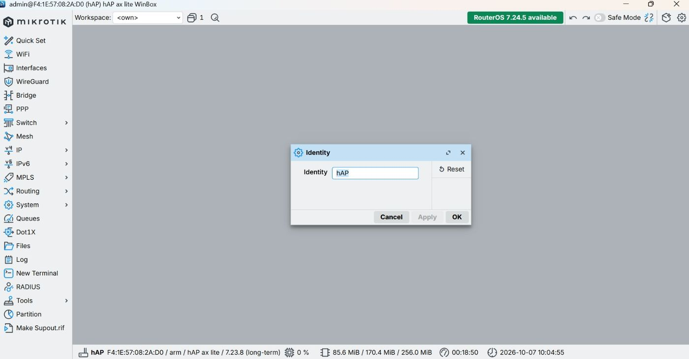](images/day1/01-identity-default.jpeg)

*Identity bawaan router (hAP)*

[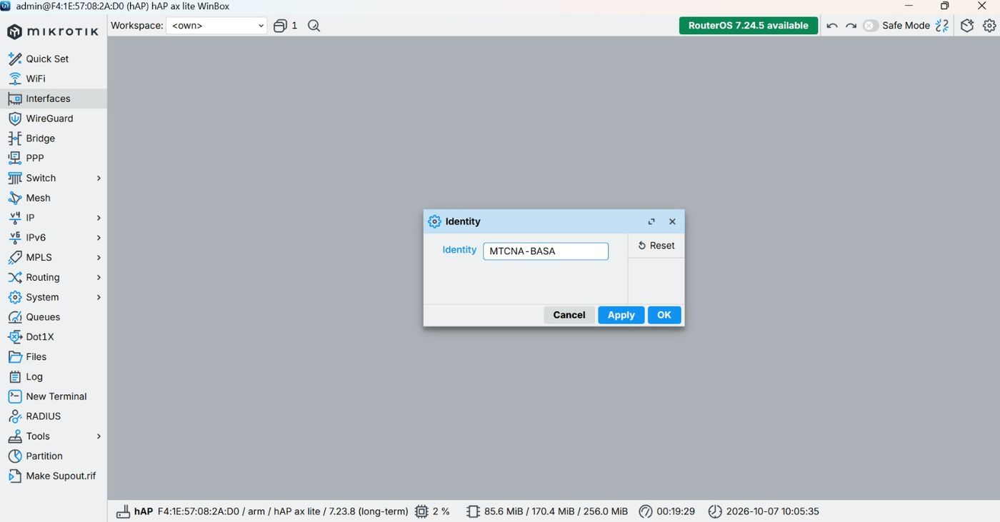](images/day1/02-identity-mtcna-basa.jpeg)

*Identity diganti menjadi MTCNA-BASA*

[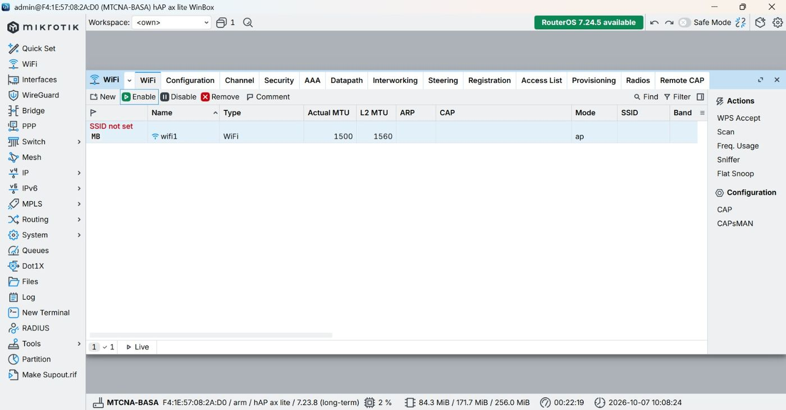](images/day1/03-wifi1-interface.jpeg)

*Interface wifi1 sebelum dikonfigurasi (SSID belum diatur)*

[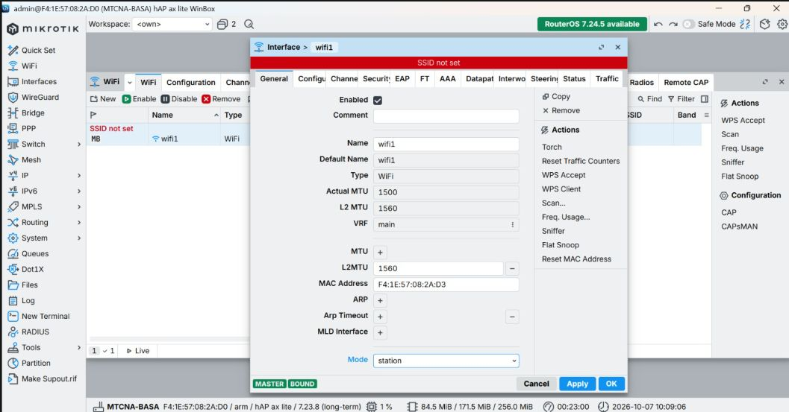](images/day1/04-wifi1-mode-station.jpeg)

*wifi1 diubah ke mode station*

[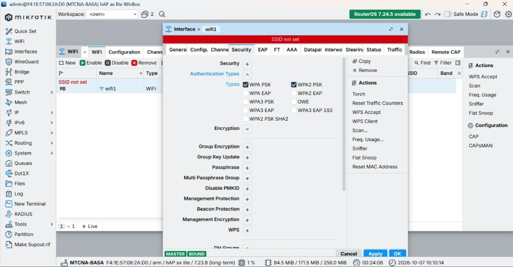](images/day1/05-wifi1-security.jpeg)

*Pengaturan keamanan wifi1 (WPA/WPA2 PSK). Passphrase tidak ditampilkan*

[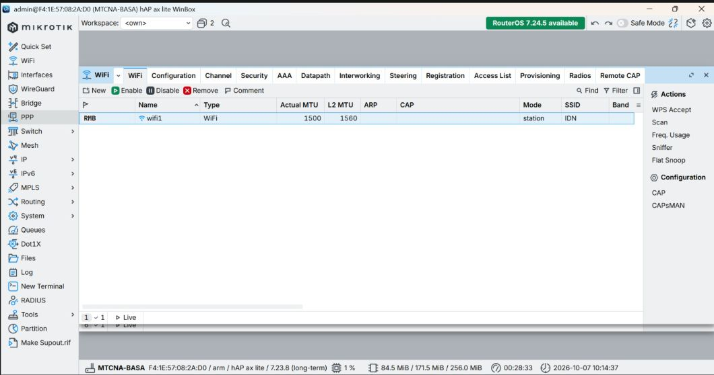](images/day1/06-wifi1-ssid-idn.jpeg)

*wifi1 terhubung ke SSID IDN dalam mode station*


**DHCP client: router mendapat IP dari uplink**

[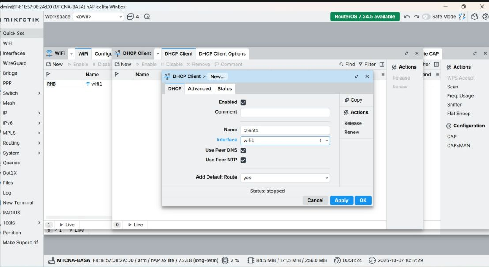](images/day1/07-dhcp-client-baru.jpeg)

*Membuat DHCP client pada wifi1*

[](images/day1/08-dhcp-client-bound.jpeg)

*Status DHCP client `bound`, IP diterima dari uplink*

[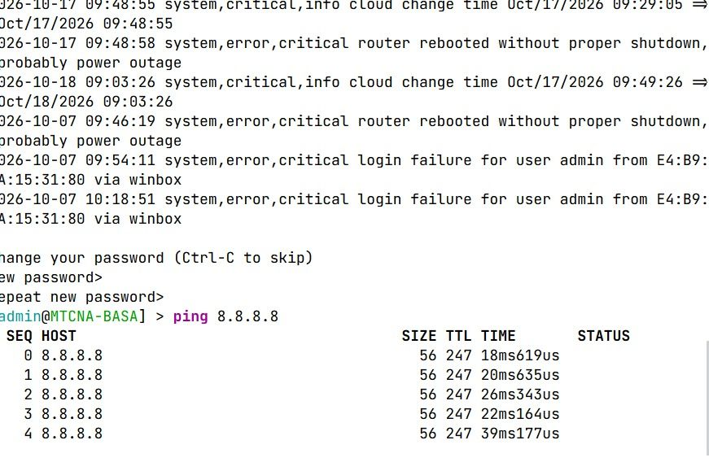](images/day1/09-ping-dari-router.jpeg)

*Ping ke 8.8.8.8 dari terminal router berhasil*


**LAN laptop dan DHCP server**

[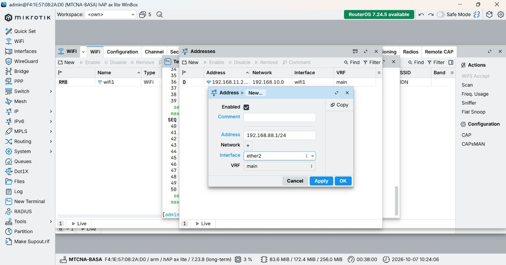](images/day1/10-ip-address-ether2.jpeg)

*Alamat 192.168.88.1/24 pada ether2*

[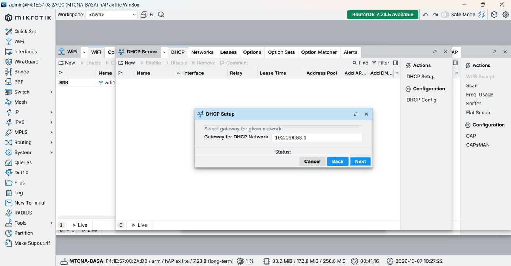](images/day1/11-dhcp-setup-gateway.jpeg)

*DHCP Setup: gateway jaringan 192.168.88.1*

[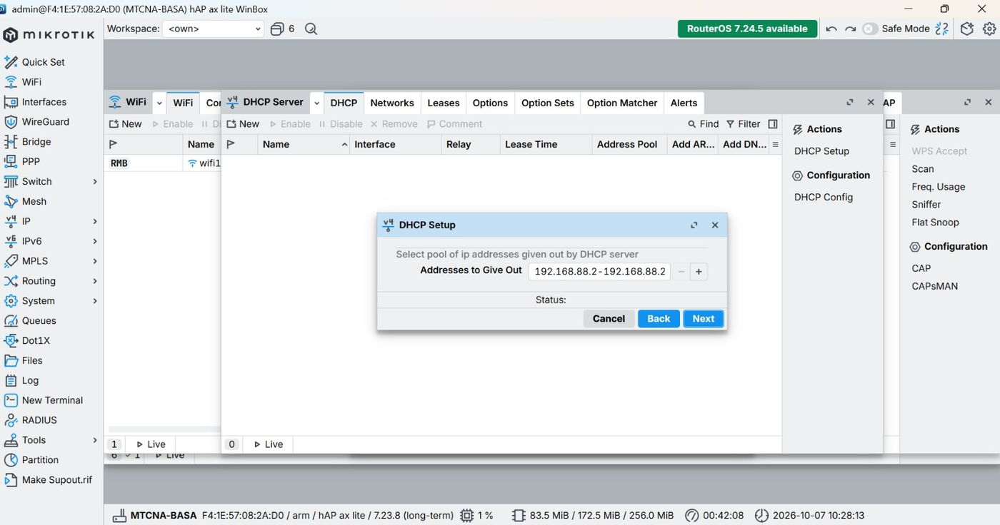](images/day1/12-dhcp-setup-pool.jpeg)

*DHCP Setup: pool alamat 192.168.88.2 - 192.168.88.254*

[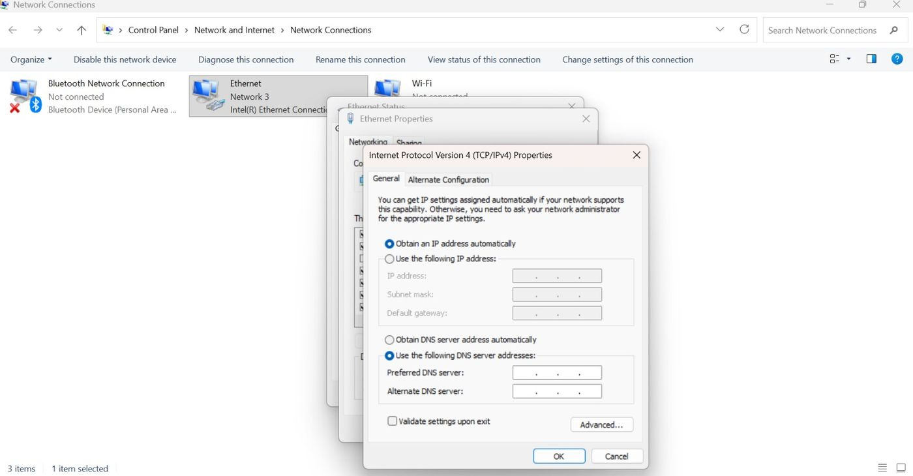](images/day1/18-laptop-dhcp-otomatis.jpeg)

*Adapter Ethernet laptop diatur ke IP otomatis*

[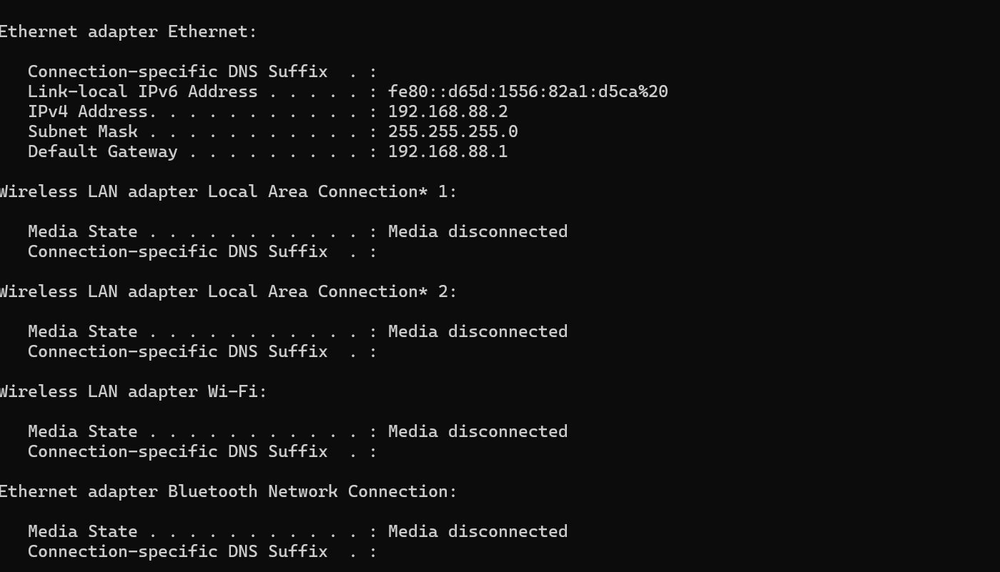](images/day1/17-ipconfig-laptop.jpeg)

*Laptop mendapat 192.168.88.2/24 dengan gateway 192.168.88.1*


**NAT: sebelum dan sesudah**

[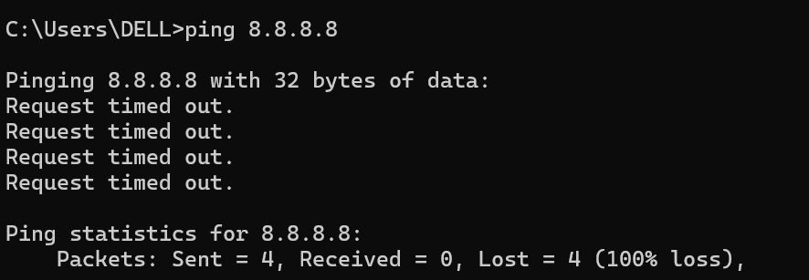](images/day1/13-ping-sebelum-nat.jpeg)

*Sebelum NAT: ping 8.8.8.8 dari laptop Request timed out (100% loss)*

[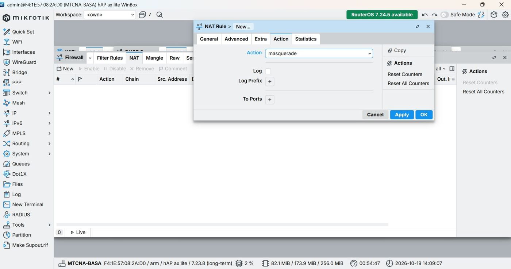](images/day1/14-nat-masquerade-action.jpeg)

*Rule NAT: action masquerade*

[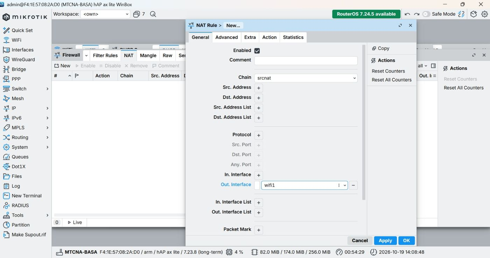](images/day1/15-nat-out-interface.jpeg)

*Rule NAT: chain srcnat, out-interface wifi1*

[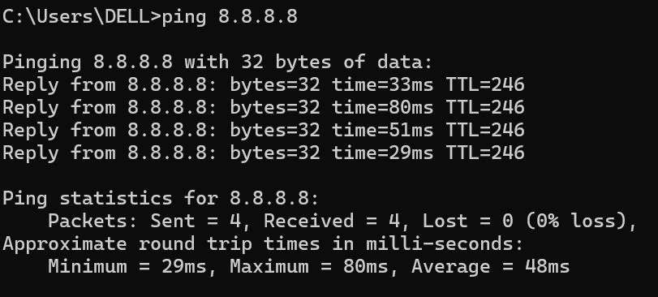](images/day1/16-ping-sesudah-nat.jpeg)

*Sesudah NAT: ping 8.8.8.8 dari laptop 4/4 balasan, 0% loss*


**Versi RouterOS**

[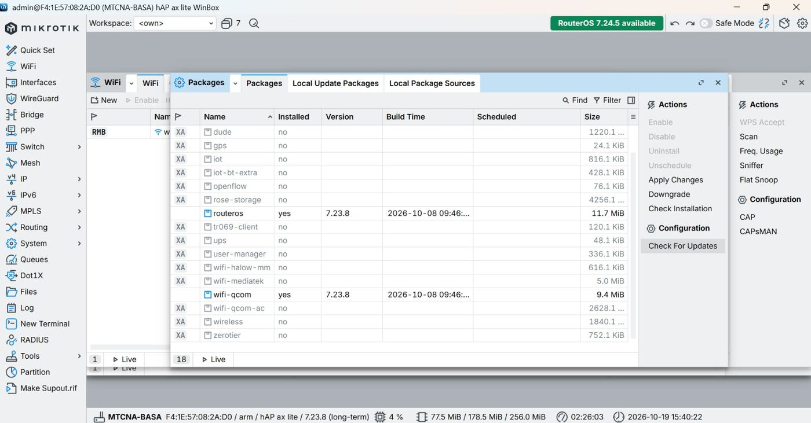](images/day1/19-packages-routeros.jpeg)

*System > Packages: RouterOS 7.23.8 terpasang*


## 7. Troubleshooting yang perlu dicek

| Gejala | Penyebab umum | Pengecekan |
|--------|---------------|------------|
| Router tidak mendapat IP dari uplink | SSID atau keamanan wifi1 salah, mode belum station | `/interface wifi print`, status DHCP client |
| Ping dari router berhasil, dari laptop gagal | NAT belum dibuat | `/ip firewall nat print` |
| Laptop tidak mendapat IP | DHCP server belum aktif di ether2 atau adapter laptop masih static | `/ip dhcp-server print`, `ipconfig` |
| Ping IP berhasil, nama domain gagal | DNS belum diisi | Cek DNS pada DHCP network dan `/ip dns` |

## 8. Yang dipelajari

- Urutan koneksi internet di RouterOS: DHCP client, DHCP server, lalu NAT
- Tanpa NAT, IP privat 192.168.88.x tidak bisa dirutekan di internet, sehingga ping dari laptop timeout padahal router sendiri sudah online
- Pada hardware RouterOS v7, Wi-Fi memakai menu `/interface wifi` (bukan `/interface wireless` seperti versi lama)
