# Day 3 - Firewall Filter, Address List, dan VPN L2TP/IPsec

> Platform: MikroTik hAP ax lite, RouterOS v7, WinBox · Training MTCNA, 21 Okt 2026

## 1. Tujuan

Mengunci akses manajemen router dengan firewall chain `input` (hanya IP admin yang boleh), memblokir kategori situs untuk klien lewat chain `forward` dengan address list, lalu menyiapkan VPN L2TP/IPsec untuk site-to-site dan akses remote work-from-home.

## 2. Topologi dan alamat

| Item | Nilai |
|------|-------|
| IP admin (satu-satunya yang boleh mengakses manajemen) | 192.168.111.253 |
| LAN klien | 192.168.88.0/24, 192.168.111.0/24, 192.168.222.0/24 |
| Port manajemen | SSH 51122, WinBox 51928, WWW 51180 |
| Tunnel VPN site-to-site | 10.10.10.1 (server) dan 10.10.10.2 (klien) |
| Pool VPN work-from-home | 10.100.1.0/24 |

## 3. Langkah pengerjaan

1. Buat rule `input` drop TCP port manajemen dari semua IP kecuali IP admin, aktifkan log dengan prefix `ACCESS-ROUTER`
2. Uji login WinBox dari IP lain: harus gagal, dan percobaan tercatat di log
3. Buat address list `IP-CLIENT` (LAN klien), `IP-SOSMED`, `YOUTUBE`, dan `IP-IDN` (domain tujuan)
4. Buat rule `forward` reject dari `IP-CLIENT` ke tiap list tujuan
5. Uji akses ke situs yang diblokir dan cek counter rule
6. Aktifkan L2TP server dengan IPsec, buat PPP secret untuk site-to-site dan profile + pool untuk work-from-home

## 4. Konfigurasi

```
# Proteksi akses manajemen
/ip firewall filter
add chain=input action=drop protocol=tcp dst-port=51122,51928,51180 \
    src-address=!192.168.111.253 log=yes log-prefix=ACCESS-ROUTER

# Address list
/ip firewall address-list
add list=IP-CLIENT address=192.168.88.0/24
add list=IP-CLIENT address=192.168.111.0/24
add list=IP-CLIENT address=192.168.222.0/24
add list=IP-SOSMED address=facebook.com
add list=IP-SOSMED address=x.com
add list=YOUTUBE address=youtube.com
add list=IP-IDN address=idn.id

# Blokir situs
/ip firewall filter
add chain=forward action=reject reject-with=icmp-network-unreachable \
    src-address-list=IP-CLIENT dst-address-list=IP-SOSMED comment=BLOCK-SOSMED
add chain=forward action=reject reject-with=icmp-network-unreachable \
    src-address-list=IP-CLIENT dst-address-list=YOUTUBE comment=BLOCK-YOUTUBE
add chain=forward action=reject reject-with=icmp-network-unreachable \
    src-address-list=IP-CLIENT dst-address-list=IP-IDN comment=BLOCK-IDN

# VPN L2TP/IPsec
/interface l2tp-server server set enabled=yes use-ipsec=yes ipsec-secret=<REDACTED>
/ip pool add name=POOL-VPN-WFH ranges=10.100.1.2-10.100.1.254
/ppp profile add name=PROFILE-VPN-WFH local-address=10.100.1.1 remote-address=POOL-VPN-WFH
/ppp secret add name=pppL2TP password=<REDACTED> local-address=10.10.10.1 remote-address=10.10.10.2
/ppp secret add name=wfh password=<REDACTED> profile=PROFILE-VPN-WFH
```

## 5. Penjelasan

| Konfigurasi | Fungsi |
|-------------|--------|
| Chain `input` | Trafik yang ditujukan ke router itu sendiri (WinBox, SSH, WWW) |
| `src-address=!192.168.111.253` | Tanda `!` berarti semua sumber KECUALI IP admin |
| `log=yes` + `log-prefix` | Percobaan akses dari IP lain tercatat dan mudah difilter di log |
| Chain `forward` | Trafik yang melewati router (klien menuju internet) |
| Address list berbasis domain | Router me-resolve domain menjadi IP dan memperbaruinya otomatis |
| `reject` | Menolak aktif dengan balasan ICMP, berbeda dengan `drop` yang diam-diam membuang paket |
| L2TP + IPsec | L2TP membuat tunnel, IPsec mengenkripsinya dengan pre-shared secret |

## 6. Verifikasi

**Proteksi akses manajemen**

[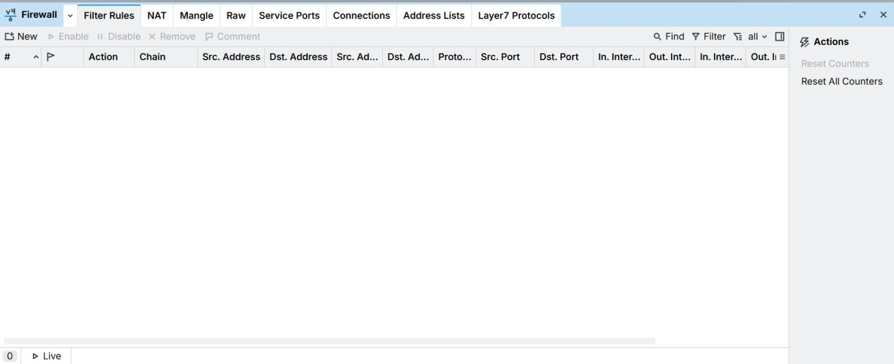](images/day3/01-firewall-kosong.jpeg)

*Tab Filter Rules masih kosong sebelum rule dibuat*

[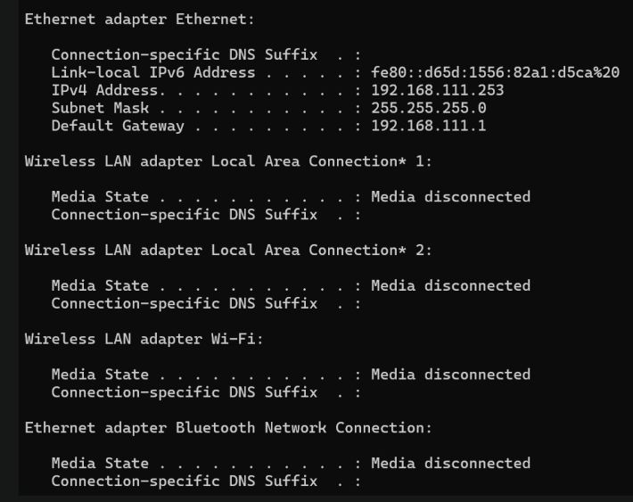](images/day3/02-ipconfig-laptop-admin.jpeg)

*Laptop admin memakai IP 192.168.111.253*

[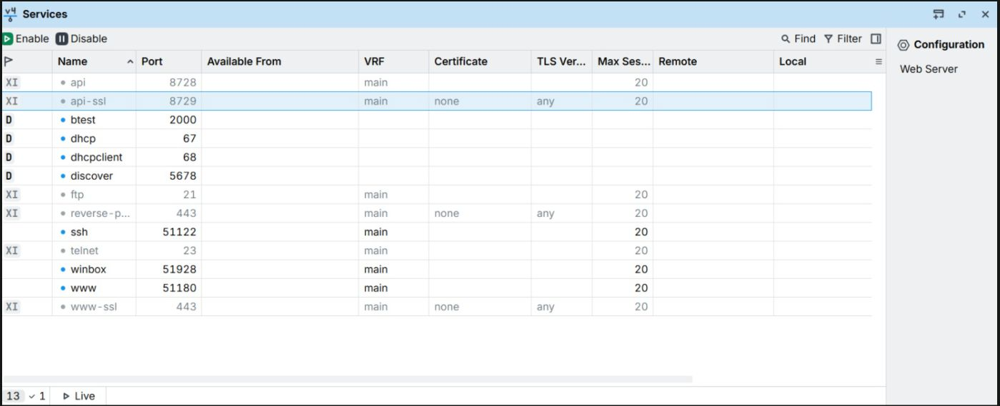](images/day3/03-ip-service-port.jpeg)

*Port layanan yang akan diproteksi*

[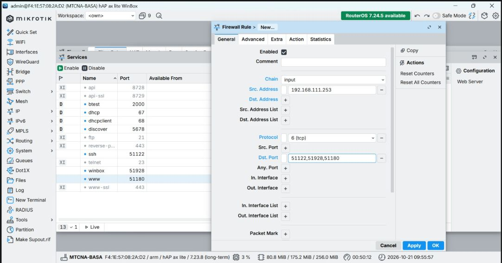](images/day3/04-rule-input-drop-port-manajemen.jpeg)

*Rule input: TCP, dst-port 51122,51928,51180*

[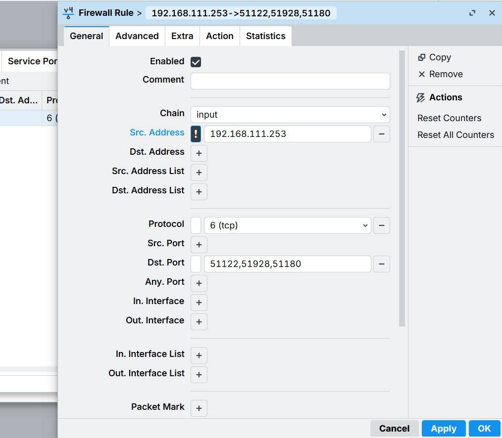](images/day3/05-rule-src-address-negasi.jpeg)

*Src. Address dengan tanda negasi (!) terhadap IP admin*

[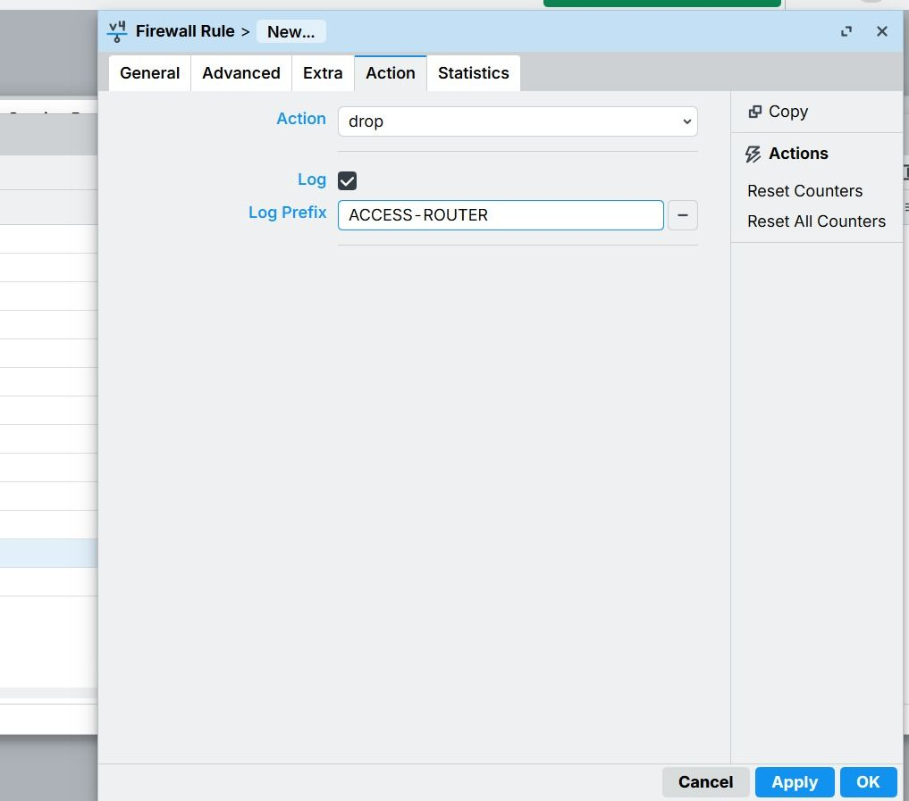](images/day3/06-rule-action-drop-log.jpeg)

*Action drop dengan log prefix ACCESS-ROUTER*

[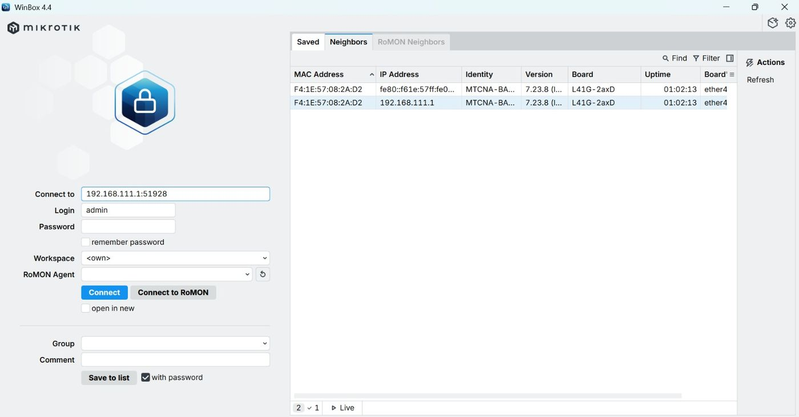](images/day3/07-winbox-login.jpeg)

*Halaman login WinBox ke 192.168.111.1:51928*

[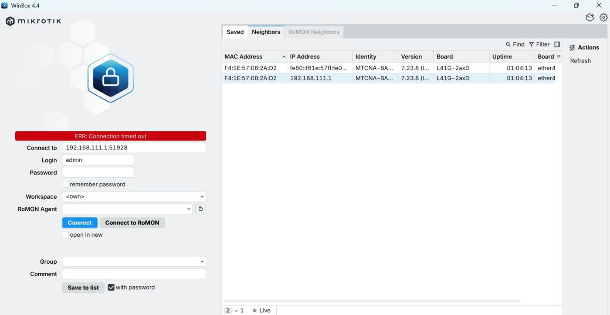](images/day3/08-winbox-connection-timed-out.jpeg)

*Login dari IP non-admin: Connection timed out (paket di-drop firewall)*

[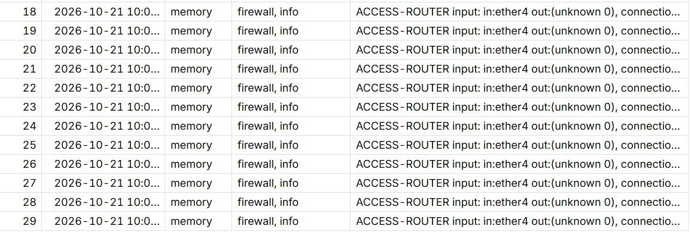](images/day3/09-log-access-router.jpeg)

*Log: percobaan akses tercatat dengan prefix ACCESS-ROUTER*

[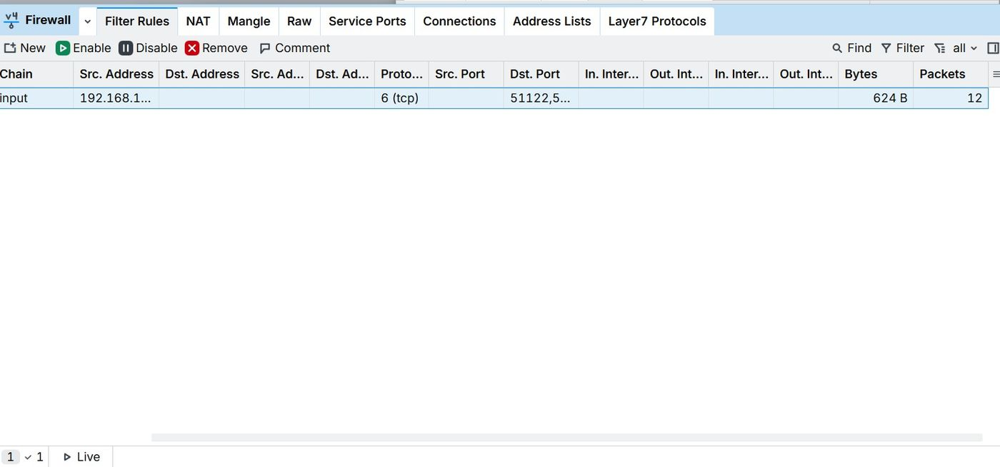](images/day3/10-counter-rule-input.jpeg)

*Counter rule input bertambah (bytes dan packets)*


**Blokir situs dengan address list**

[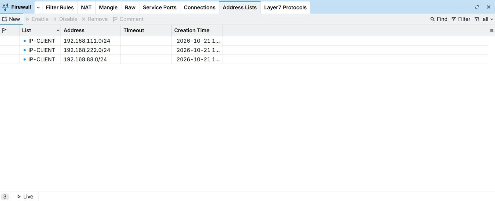](images/day3/11-address-list-ip-client.jpeg)

*Address list IP-CLIENT berisi tiga segmen LAN*

[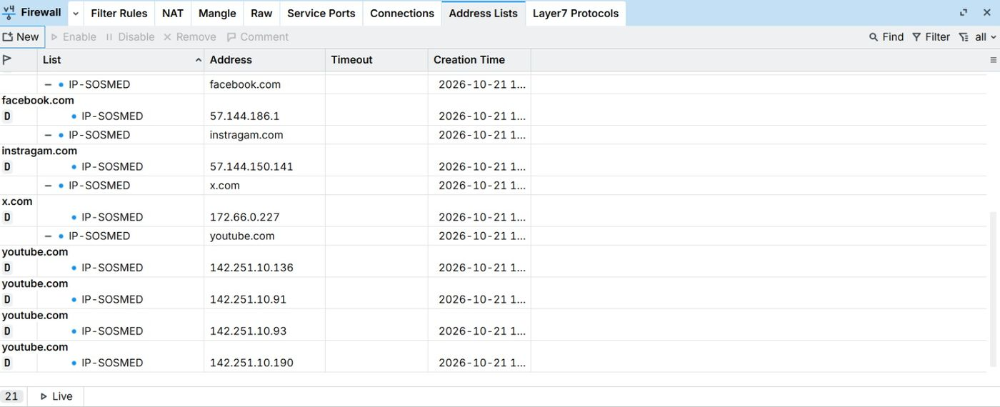](images/day3/12-address-list-ip-sosmed.jpeg)

*Domain di-resolve otomatis menjadi IP pada address list*

[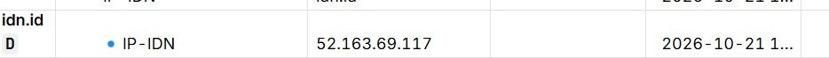](images/day3/13-address-list-ip-idn.jpeg)

*Address list IP-IDN (idn.id)*

[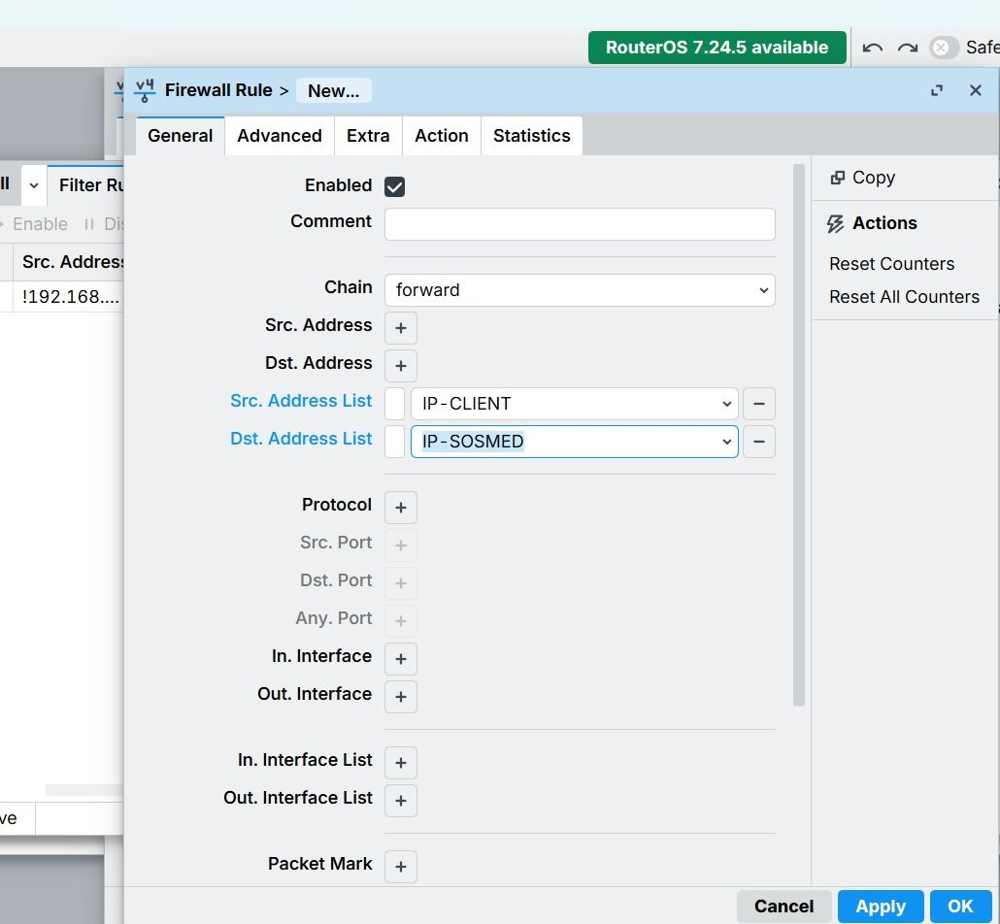](images/day3/14-rule-forward-reject.jpeg)

*Rule forward: src IP-CLIENT, dst IP-SOSMED*

[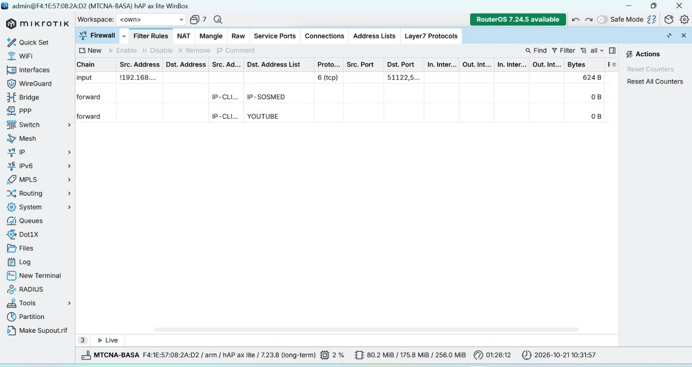](images/day3/15-filter-rules-counter.jpeg)

*Daftar rule filter beserta counter*

[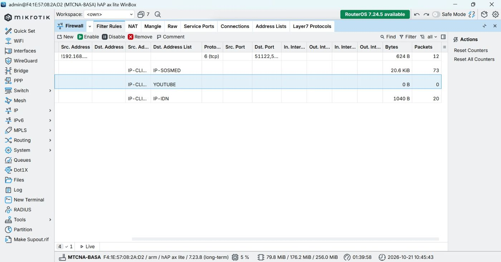](images/day3/16-filter-rules-counter-lanjut.jpeg)

*Counter rule blokir bertambah saat situs diakses*

[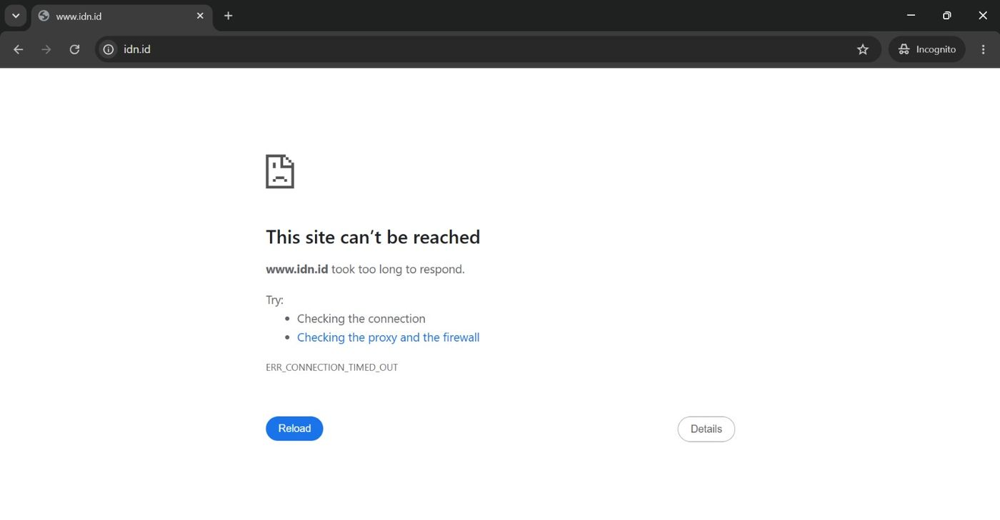](images/day3/17-uji-blokir-idn.jpeg)

*Uji akses idn.id dari klien: ERR_CONNECTION_TIMED_OUT*


**VPN**

[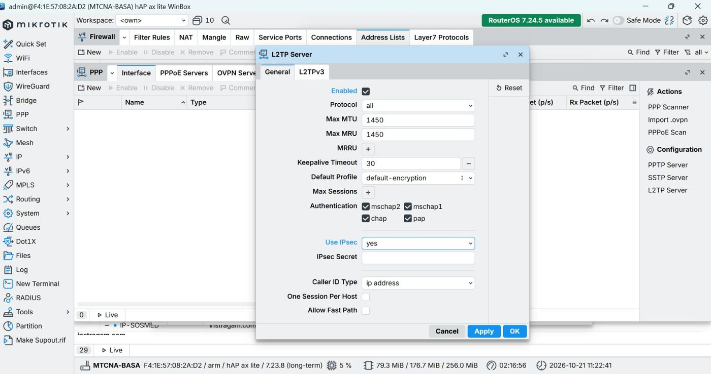](images/day3/18-l2tp-server-ipsec.jpeg)

*L2TP Server diaktifkan dengan Use IPsec: yes*


## 7. Troubleshooting yang perlu dicek

| Gejala | Penyebab umum | Pengecekan |
|--------|---------------|------------|
| Admin sendiri terkunci dari router | IP admin salah atau rule input diletakkan sebelum IP admin dipastikan | Aktifkan **Safe Mode** WinBox sebelum menerapkan rule input |
| Situs tidak terblokir | Nama list di rule tidak sama dengan nama list di address list (termasuk spasi) | `/ip firewall address-list print`, cocokkan dengan rule |
| Address list domain kosong | Router tidak bisa me-resolve DNS | `/ip dns print`, `ping <domain>` dari router |
| Counter rule tidak naik | Urutan rule, atau trafik tidak melewati chain yang dimaksud | Cek posisi rule dan chain (`input` atau `forward`) |
| VPN tidak terhubung | Secret IPsec berbeda, atau port UDP 500/4500/1701 terblokir | `/log print where topics~"ipsec"` |

## 8. Yang dipelajari

- `input` melindungi router, `forward` mengatur trafik pengguna. Keduanya sering tertukar
- Selalu uji rule pembatas akses dengan Safe Mode atau akses konsol agar tidak terkunci
- Nama address list harus sama persis (spasi di akhir nama juga dianggap bagian dari nama)
- Reject memberi umpan balik ke klien, drop membuat koneksi menggantung sampai timeout
